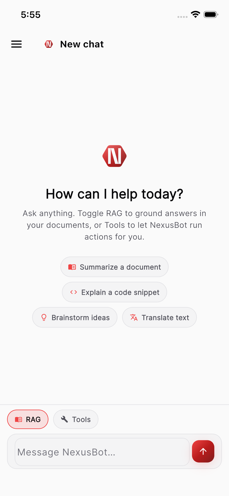
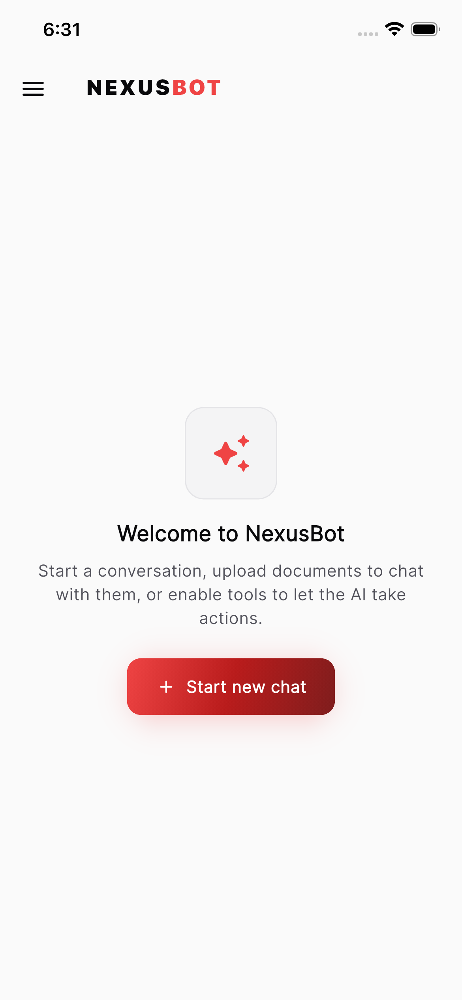
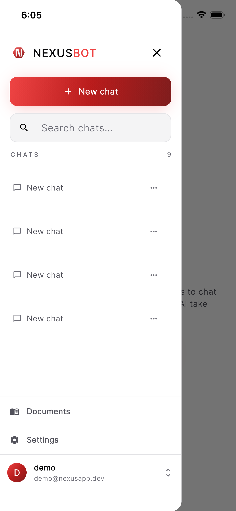

<div align="center">


# NexusBot — Flutter App

**The official cross-platform client for the [NexusBot](https://github.com/yosefyosef13054/NEXUSBOT) AI chat backend.**

A production-grade Flutter front end for multi-session AI chat — real-time token streaming, document-grounded answers (RAG), tool calling, and JWT auth — with one adaptive UI that runs on **iOS, Android, web, macOS, Windows, and Linux**.

[](https://flutter.dev)
[](https://dart.dev)
[](https://riverpod.dev)
[](LICENSE)

</div>

---

## 📱 Screenshots

| Sign in | Chat | Sidebar |
|:---:|:---:|:---:|
|  |  |  |

---

## ✨ What it is

NexusBot's Flutter app is a thin, well-architected client over the NexusBot REST / SSE / WebSocket API. It owns **no business logic** — every answer, citation, and tool call comes from the backend — so the UI stays simple while the server does the heavy lifting. The same JSON event format is consumed identically over SSE and WebSocket, so the chat experience is transport-agnostic.

### Highlights

- 💬 **Multi-session chat** — create, rename, delete, and full-text search across conversations, with persistent history.
- ⚡ **Real-time streaming** — assistant replies render token-by-token over **SSE** (default) or **WebSocket** (toggle in settings). A **Stop** button interrupts generation; the partial reply is kept and marked *Stopped*.
- 🧠 **Server-driven models** — the model list comes from `GET /models` (display name, provider, context window, price per 1M tokens). Pick an account-wide default in Settings, switch a chat's model from its header, or override it for a single message from the composer.
- 📚 **RAG toggle + Knowledge scope** — ground answers in your uploaded documents, optionally restricted to chosen **collections**; structured citations show document, page and section, and open a chunk viewer.
- 🛠 **Tools toggle + picker** — let the backend agent call tools (calculator, web search, DB lookups). A per-chat picker chooses which tools it may use; tool runs surface live as collapsible chips and are persisted as their own `role: "tool"` history rows.
- 🛡 **Human-in-the-loop approvals** — tools that need permission pause the turn with an approval card (tool, description, input); **Approve** / **Deny** resumes the stream into the same bubble, on SSE or WebSocket, and survives an app restart.
- 🗂 **Collections & URL ingestion** — group documents into knowledge bases, move documents between them, filter the library, and add web pages by URL.
- 🔎 **Full-text message search** — the sidebar searches message contents server-side and renders the server's `<mark>` highlights.
- 🏢 **Organizations** — every user has a personal workspace and can create shared ones; the sidebar switches the **active org** (`X-Org-Id` on every request, `org_id` in the WebSocket auth frame). Owners / admins rename the workspace, set monthly budgets, restrict models and manage members by email.
- 📊 **Usage & quotas** — tokens, cost and messages for you and your workspace with budget progress bars; a spent budget (`429 quota_exceeded`) shows a persistent banner and pauses the composer until it resets. Admins get per-member / model / day reports; server admins a cross-org report and the feedback inbox.
- 🧑‍💼 **Assistants** — personas with their own avatar, system prompt, model, tools, knowledge scope, temperature and memory setting. **New chat** picks one (default preselected); the chat header swaps it.
- 👍 **Feedback** — thumbs up / down on every reply (with an optional comment on thumbs-down), persisted and reflected on reload.
- 🧠 **Memory** — NexusBot remembers facts, preferences and standing instructions across chats; a **Memory** screen lists, edits and forgets them, and replies that used memories say so.
- 🌿 **Branching** — edit a user message in place (the reply streams into a new branch) or regenerate; a "‹ 2/3 ›" switcher walks the siblings.
- 🔁 **Resumable & background turns** — a dropped stream reconnects once from the last frame; a chat that opens mid-reply attaches to the running generation; "Send in background" lets the server finish even if the app goes away. Every send carries an `Idempotency-Key`.
- 🖼 **Attachments & vision** — attach photos (library / camera) and files (PDF, Word, text, CSV, JSON, audio) from the composer; uploads show as chips, go out as `attachment_ids`, and render on the bubble as an image grid (tap for full screen) or file chips ("Transcribed", "Text extracted"). Images need a model with `supports_vision` — the picker says so otherwise.
- 📎 **Artifacts** — files a tool produces (`run_python` plots, generated documents) stream in as `artifact` frames and show as cards under the reply with an inline preview and download.
- 🎙 **Voice** — push-to-talk records a clip and sends it through `/messages/voice`; the transcript becomes the user bubble and the reply streams back. "Speak replies" plays `audio_chunk` frames as they arrive, replies keep a **Play reply** button, and Settings picks the voice.
- 🧩 **MCP servers** — org admins register Model Context Protocol tool servers (HTTP / SSE; stdio for server admins), test the connection and toggle approval; the tool picker groups tools by **Built-in** / server.
- 📤 **Export & share** — download a chat as Markdown or JSON (share sheet / browser download) or mint a read-only link with an expiry, copy / share it, and revoke links from a sheet.
- 🔔 **Push notifications** — a `PushService` abstraction registers the device token with `/devices` and routes `generation_done` taps to the chat, attaching to the finished generation (FCM is a documented stub behind `--dart-define=PUSH_PROVIDER=fcm`).
- 📴 **Offline-first** — the session list, the last 100 messages of every chat you open, your assistants and your profile are cached on the device (per user and workspace). Chats open from the cache and refresh over the network, older history loads on demand (`?cursor=` pagination), and a message sent while offline — or into a dropped connection — shows as *Queued* and is replayed in order on reconnect through `POST /messages/background` with its original `Idempotency-Key`. A banner shows the offline state and the queue.
- 🌍 **Localized & RTL-ready** — English, Hebrew and Arabic (ICU plurals) from ARB files through `flutter gen-l10n`; the language follows the device or a Settings choice, and every layout uses logical (start / end) geometry so Hebrew and Arabic mirror correctly while code blocks and JSON stay left-to-right.
- 📥 **Share into NexusBot** — the system share sheet (text, links, images, PDF, Word, Markdown, CSV, HTML, audio) opens a chat picker: start a new chat or pick an existing one; text prefills the composer and files upload as attachments. Wired for Android; the iOS share extension is documented below.
- ⌨️ **Desktop shortcuts** — Ctrl / ⌘ N starts a chat, Ctrl / ⌘ K focuses search, Esc stops a reply, Enter sends and Shift + Enter inserts a newline (desktop and web only).
- 🔒 **Biometric lock** — optional Face ID / Touch ID / fingerprint unlock (`local_auth`) on cold start and after two minutes in the background; off by default.
- 📜 **Store-ready** — a `/legal` screen (privacy policy + terms template), an About section with the running version (`package_info_plus`) and licences, optional Sentry crash reporting (`--dart-define=SENTRY_DSN=…`), fastlane lanes for Play internal testing and TestFlight, and a tag-triggered release workflow.
- 🔐 **JWT auth** — register / login, tokens stored in the platform secure store, with **transparent, single-flight access-token refresh** on `401` (and proactively before a stream opens). Rotating refresh tokens, server-side sign-out, change password, edit display name and delete account.
- 📄 **Document upload** — pick a file, upload, and watch ingest status update.
- 🎨 **Adaptive, branded UI** — a navigation **drawer on mobile** and a **persistent sidebar on tablet/desktop**, dark/light themes, crimson brand, Markdown + syntax-highlighted code blocks.

---

## 🏗 Architecture

The app follows a clean **feature-first** structure with a small shared core. State is managed with **Riverpod**, navigation with **go_router** (including an auth-aware redirect), and all networking flows through a single authenticated **Dio** client.

```
┌──────────────────────────────────────────────────────────┐
│  Screens (features/*/.._screen.dart)                       │  Widgets
├──────────────────────────────────────────────────────────┤
│  Controllers / Providers (Riverpod StateNotifier)          │  UI state
├──────────────────────────────────────────────────────────┤
│  Repositories (auth · chat · documents · collections ·     │  API calls
│                models · tools · orgs · usage · assistants · │
│                memory · admin)                             │
├──────────────────────────────────────────────────────────┤
│  Core: ApiClient (Dio+JWT) · SSE/WS · SecureStorage · Env  │  Plumbing
└──────────────────────────────────────────────────────────┘
                         │ REST · SSE · WebSocket
                         ▼
                  NexusBot backend (/api/v1)
```

### How the pieces fit

| Concern | Where | Notes |
|---|---|---|
| **State management** | `flutter_riverpod` | `StateNotifier` for live chat state; `FutureProvider` for repositories / session lists. |
| **Navigation** | `go_router` (`core/router.dart`) | Real URLs. A `ShellRoute` keeps the sidebar mounted while `/`, `/chat/:sessionId`, `/documents`, `/collections`, `/assistants`, `/memory`, `/orgs/:id`, `/admin/*` and `/settings` swap underneath it; a redirect bounces unauthenticated users to **/login** and authenticated users away from auth screens. A browser refresh on `/chat/<id>` reopens that chat. |
| **HTTP** | `dio` (`core/api_client.dart`) | One client injects `Authorization: Bearer <jwt>` and — while a workspace other than the personal one is active — `X-Org-Id` on every request, and maps every non-2xx envelope to a typed `ApiException` (with the server's `request_id`). An interceptor catches `401`, refreshes through the **single-flight** `TokenRefresher` (`core/auth_session.dart`) — concurrent 401s await the same refresh — retries once, and only fails if the refresh itself fails. |
| **Streaming** | `dio` (SSE) + `web_socket_channel` | `ChatRepository.streamMessage` opens a `ChatTurn` on the chosen transport; both emit the same `StreamEvent` types so the controller doesn't care which is active. SSE goes through the same Dio client (`ApiClient.openEventStream` + a tiny `core/sse_parser.dart`), so auth refresh applies to streams too. |
| **Secrets** | `flutter_secure_storage` | Access + refresh tokens live in Keychain / Keystore, never in plain prefs. |
| **Preferences** | `shared_preferences` (`core/preferences.dart`) | Theme mode, transport (SSE/WS), preferred model, streaming on/off, RAG-by-default, tools-by-default, the active organization (stored with the user who chose it), plus per-chat tool selections (`SessionPrefs`, keyed by session id). |
| **Catalogs** | `features/models`, `features/tools`, `features/collections`, `features/assistants`, `features/orgs` | `GET /models`, `GET /tools`, `GET /collections`, `GET /assistants` and `GET /orgs` are loaded once per app session into plain `FutureProvider`s (pull-to-refresh invalidates them); the chat screen, Settings and Documents all read the same cache. Org-scoped providers watch the active org id and reload on a switch. |
| **Theming** | `core/theme.dart` + `google_fonts` | Crimson brand tokens, dark/light, spacing / radius scales. |
| **Adaptive layout** | `core/breakpoints.dart` + `shared/home_shell.dart` | `< 720` → drawer; `≥ 720` → persistent sidebar; `≥ 1100` → desktop spacing. |

### Routes

| Location | Screen | Notes |
|---|---|---|
| `/splash` | Splash | Resolves the stored session, then goes to `/` or `/login`. |
| `/login`, `/register` | Auth | Unreachable while signed in. |
| `/` | Landing | Opens the most recent chat automatically, or shows a **New chat** call to action. |
| `/chat/:sessionId` | Chat | Deep-linkable; the sidebar highlights the open session. Header shows the session model with a switch menu and a ⋮ menu (export, share link). `?generation=<id>` (what a push notification opens) attaches to that generation. |
| `/documents` | Documents | Upload (with an optional collection), add from URL, collection filter, move to collection, ingest status. |
| `/collections` | Collections | Create, rename, delete (optionally with the documents) knowledge bases. |
| `/assistants`, `/assistants/new`, `/assistants/:id` | Assistants | The workspace's personas: list, create / edit form, delete. |
| `/memory` | Memory | "What NexusBot remembers": list by kind, add, edit, forget, clear all. |
| `/orgs/:id` | Workspace | Name, budgets, allowed models, members (read-only for plain members). |
| `/orgs/:id/usage` | Usage report | Owner / admin: date range, group by user / model / day, bar list. |
| `/orgs/:id/mcp` | MCP servers | Owner / admin: list, add (HTTP / SSE; stdio for server admins), edit, test connection, enable / approval toggles, remove. Linked from the workspace screen. |
| `/admin/usage`, `/admin/feedback` | Administration | Server admins only (`UserRead.role == "admin"`): cross-org usage, feedback inbox. |
| `/settings` | Settings | Workspace, usage, appearance, language, chat defaults (incl. memory), voice, model (from the server), security (biometric unlock), offline (clear saved chats), administration, about (version, privacy & terms, licences), account. |
| `/share` | Share intake | Opened when something is shared into the app: a preview of the text / files, **New chat** or an existing chat to continue in; the chat then opens with the composer prefilled and the files uploading. |
| `/legal` | Privacy & terms | Reachable signed-out; linked from the login screen and Settings → About. |

Everything below the auth screens lives inside one `ShellRoute` (`shared/home_shell.dart`), so the drawer (mobile) / persistent sidebar (tablet, desktop) never remounts between pages. Sidebar taps and **New chat** simply `context.go(...)`.

### Models

- `ModelsRepository` loads `GET /models` once per app session (`modelCatalogProvider`); Settings → **MODEL** lists the server's models with a provider badge, context window and price-per-1M hint, and pull-to-refresh reloads the list. An empty list hides every model picker.
- Selecting a model in Settings stores it locally **and** on the account (`PATCH /auth/me {default_model}`). `defaultModelIdProvider` resolves the effective default as *account default → local preference → server default*, only ever picking an id the catalog lists, so **New chat** never sends a model the server would reject with `422`.
- The chat header shows the session's model (fallback: the resolved default) with a menu that calls `PATCH /sessions/{id} {model}`. The composer's model chip is a per-message override sent as `model` on the turn (SSE body and WS frame alike); "Session model" clears it.
- `done.data.model` / `assistant_message.data.model` are kept on the message and shown as a muted caption (with a tooltip) in the actions row that appears on hover / long-press.

### Approvals (human-in-the-loop)

Tools flagged `requires_approval` in `GET /tools` make the agent pause mid-turn:

1. The stream emits `approval_required` (`approval_id`, `message_id`, `expires_at`, the `tool_calls` with name / description / input) and then **ends normally** with `done` + `assistant_message`, both `status: "awaiting_approval"` — the assistant message is a persisted placeholder carrying the same `approval` object.
2. The controller attaches the approval to the bubble; `ApprovalCard` renders each tool call with pretty-printed input and **Approve** / **Deny**.
3. `ChatRepository.resolveApproval(sessionId, approvalId, decision)` returns a `ChatTurn`: over SSE it is `POST /sessions/{id}/approvals/{approvalId}` read as an event stream; when the WebSocket transport is active it sends an `{"type":"approval"}` frame and listens on the socket. The controller streams the continuation (`tool_call`, `token`, `done`, `assistant_message`) **into the same bubble** — the final `assistant_message.data.id` equals the placeholder id and replaces it in place. Deny follows the same path; the model finishes without the tool.
4. On open, history rows with `meta.status == "awaiting_approval"` show the card from `meta.approval`, and `GET /sessions/{id}/approvals?status=pending` reconciles them: a pending approval is attached to its message, a stale one loses its buttons (marked *expired* / *resolved*). A `409` / `404` on resolve (SSE) or a `conflict` / `not_found` error frame (WS) refreshes the history.

### Tool messages

Tool runs are persisted as `role: "tool"` messages (`meta.tool`, `call_id`, `input`, `status` ok / error / denied, `latency_ms`; the content is the output) between the user message and its reply. `ChatMessage.fromJson` turns each into a one-run `ChatMessage` (`isToolRun`), rendered by `ToolCallChips` as collapsible **Tool: name** pills with a status icon and latency that expand to input / output — never as a bubble. Live `tool_call` events (now with `call_id`) upsert into the streaming bubble's strip, the final `assistant_message.tool_calls` replaces it, and the screen hides any `call_id` already shown by a tool row directly above, so a reload looks exactly like the live turn. The non-streaming path and **Regenerate** get the rows directly (`tool_messages[]` in the response) and insert them before the reply.

### Citations viewer

Citations are structured (`document_id`, `document_name`, `chunk_id`, `chunk_index`, `page`, `section`, offsets, `collection_id`, `score`, `excerpt`). The strip shows the document name plus `p. 4 · 2. Scope > 2.1 Goals`; tapping a card opens `CitationSheet`, which fetches `GET /documents/{document_id}/chunks/{chunk_id}` (`DocumentsRepository.getChunk`; `listChunks` pages through a document) with loading / error states, shows the score and the full chunk text, and offers **Open in Documents**.

### Collections & knowledge scope

- `features/collections`: `CollectionsRepository` (`POST/GET/PATCH/DELETE /collections`, `delete_documents` flag) and the `/collections` screen (create, rename / describe, delete with an "also delete the documents" checkbox, tap to open the filtered library).
- Documents: a collection filter row (`GET /documents?collection_id=`), **Move to collection…** in the tile menu (`PATCH /documents/{id} {collection_id}`, `null` unassigns), an optional collection choice when uploading, and **Add from URL** (`POST /documents/from-url` with an optional collection; `422` messages for unreachable / unsupported / private URLs are shown inline).
- Chat: the composer's **Knowledge** chip picks the collections this chat searches. The choice is saved as the session default (`PATCH /sessions/{id} {"meta": {"collection_ids": [...]}}`, merged with the existing meta) and sent as `collection_ids` on every turn; *All documents* sends `null`.

### Organizations & the active workspace

- Every user owns a **personal** org (created at registration); `POST /orgs` creates a shared one with the creator as owner. `features/orgs`: `OrgsRepository` (list / create / get / patch, members list / add / patch / remove) and the `/orgs/:id` screen.
- The **active org** is chosen in the sidebar header (`OrgSwitcher`) and stored in prefs together with the user id that chose it, so another account on the same device never inherits it. `currentUserProvider` installs it on the `ApiClient`: every request then carries `X-Org-Id` (absent = personal), and the WebSocket `auth` frame carries `org_id`. A stale choice (the user was removed, the org deleted) makes the server answer `403 forbidden`; `orgListProvider` resets the choice to the personal workspace and reloads.
- Switching invalidates the sessions, documents, collections, assistants, memories and usage providers (they all watch `activeOrgIdProvider`) and navigates to `/`.
- `/orgs/:id` for owners / admins: rename, monthly budgets (`settings.budget_usd_per_month`, `budget_tokens_per_month`; empty = no limit), allowed models (multi-select from the catalog, "all" = `null`), members with role chips, invite by email (`404` → "no NexusBot account uses that email", `409` → "already a member"), change role, remove; the owner can never be removed and a member may leave. Plain members see a read-only member list. Org ids are never shown — only names.

### Usage & quotas

- `GET /usage/me` feeds Settings → **USAGE** (your and the workspace's tokens / cost / messages for the period, a progress bar per budget) and the compact **meter** in the sidebar footer; it is re-fetched after every completed turn.
- When the workspace budget is spent, every generation request answers `429` with code `quota_exceeded` (`details`: the budget, what was used and `resets_at`) — over a stream it arrives as an `error` frame with the same code. The chat controller puts a `QuotaExceeded` into the app-wide `quotaStateProvider`: the chat shows a persistent banner with the figures and the reset time, the composer is disabled, and **Refresh** re-checks `/usage/me` (the banner clears once the budget allows turns again or the reset moment has passed).
- Owners / admins get `/orgs/:id/usage` (`GET /orgs/{id}/usage?from&to&group_by=user|model|day`): this month / last 30 days / custom range, group by, totals and a simple bar list (cost / tokens / messages — no chart library). Server admins additionally get `/admin/usage` (`group_by=org` too) and `/admin/feedback` (paged list of thumbs with comments and a link to the chat), linked from Settings only when `role == "admin"`.

### Assistants

- `features/assistants`: `AssistantsRepository` (`GET /assistants` paged, `POST`, `GET/PATCH/DELETE /assistants/{id}`), `assistantListProvider` (org-wide) and `defaultAssistantProvider`.
- `/assistants` lists avatar, name, model and a **DEFAULT** badge; the form (`/assistants/new`, `/assistants/:id`) edits name, description, avatar emoji, system prompt, model (from the catalog), RAG / tools toggles with a tools multi-select (`GET /tools`) and a collections multi-select, a custom-temperature slider, memory and default flags. Only the creator or an org admin may edit or delete — the form is read-only otherwise and a `403` surfaces the same message. `is_default: true` clears the previous default server-side.
- **New chat** (sidebar and landing page) opens a small sheet when the workspace has assistants — *Plain chat* plus every assistant, the default preselected — and sends `assistant_id` on `POST /sessions`. The chat header shows the assistant's avatar / name with a menu that calls `PATCH /sessions/{id} {assistant_id}` (null = plain chat). A session with an assistant uses its prompt, model, tools, collections and memory setting as defaults; per-turn fields still override.

### Feedback

Thumbs up / down live in the actions row of every finished reply (`FeedbackButtons`). A thumbs-down first opens an optional comment sheet; `POST /sessions/{id}/messages/{mid}/feedback {rating, comment}` upserts, tapping the active rating again `DELETE`s it. History rows reflect `meta.feedback`, and the message is updated optimistically (reverted on failure).

### Memory

- `features/memory`: `MemoryRepository` (`GET /memories` paged, `POST`, `PATCH/DELETE /memories/{id}`, `DELETE /memories`) and the `/memory` screen — "What NexusBot remembers", grouped into facts / preferences / instructions with importance dots and the last-used date; add, edit, forget, and a confirmed **Forget all**.
- Settings → CHAT has the account-wide **Memory** switch (`PATCH /auth/me {memory_enabled}`); memories are only extracted and injected when the server, the user and the assistant allow it. The memory screen shows a hint when it is off.
- A reply whose `meta.memories_used` is non-empty gets a subtle "Used N memories" caption; tapping it opens the memory screen.

### Branching (message tree)

- Messages carry `parent_id` and `siblings: {index, count}` (user messages: edits; replies: regenerations), sessions `active_leaf_id`. `GET /sessions/{id}/messages` returns the active branch only, so the list stays linear.
- Under any message with `siblings.count > 1` a **‹ i/n ›** switcher appears (`index` is zero-based, shown one-based). An arrow calls `GET …/{message_id}/siblings`, picks the neighbour of `active_index` (wrapping), then `POST /sessions/{id}/branch {leaf_message_id}` — the server makes that sibling's latest descendant the leaf — and the returned history replaces the message list.
- **Edit** in a user message's actions opens an inline editor; *Save & send* calls `POST …/{message_id}/edit` streamed exactly like `/messages/stream` (SSE): the optimistic user bubble is replaced by the persisted `user_message` (which carries `parent_id`), the reply streams into a new bubble and everything after the edited message disappears because the branch changed. Stop and approvals work on edited turns like on any other.
- **Regenerate** keeps the blocking endpoint; the previous reply stays as a sibling, so the active branch is reloaded from the server afterwards to pick up the counts.

### Resumable streams, background turns, idempotency

- Every streamed turn has a `generation_id` (`user_message.data.generation_id`, also on `done` / `assistant_message`) and every SSE frame an `id: <seq>` line; `core/sse_parser.dart` exposes it and `ChatTurn` tracks `generationId` and `lastEventId` as frames arrive.
- On a transport error mid-stream (not a user stop) — or a stream that ends without a terminal event — the controller reconnects **once** through `GET /sessions/{id}/generations/{generation_id}/events?after=<last seq>` (also sent as `Last-Event-ID`) and keeps streaming into the same bubble; a WebSocket turn has no cursor, so the replay starts from the first frame and the buffer is reset first. If the reconnect fails (e.g. `404`, the generation expired), the usual error path applies.
- When a chat opens, `GET /sessions/{id}/generations/active` is called; a `running` generation is attached to via the same replay into a streaming bubble for its user message (a replayed `user_message` that is already in the history is not duplicated). Stop on an attached stream only detaches — the server finishes the reply.
- **Send in background** (composer overflow menu) uses `POST /sessions/{id}/messages/background` (202 with `generation_id` and the persisted `user_message`), then attaches; the reply is produced even if the app disconnects.
- Every send attempt — `/messages`, `/messages/stream`, `/messages/background` and `/messages/{id}/edit` — carries a fresh UUID `Idempotency-Key`; Dio's transparent 401 retry resends the same request, so a retry within 24 h replays the original turn instead of creating a duplicate.

### Attachments & vision

- `features/attachments`: `Attachment` (parses the full `AttachmentRead` and the compact summary alike), `AttachmentsRepository` (`POST /sessions/{id}/attachments` multipart, list / get / delete, `resolveUrl`, `fetchContent`) and `AttachmentPicker` (`image_picker` for the library / camera, `file_picker` for documents and audio clips; behind an interface so the screen is testable).
- The composer's paper-clip menu uploads first; the result waits as a chip (thumbnail or kind icon, size, remove) in `ChatState.pendingAttachments` and every send path — stream, blocking, background, edit and the WebSocket `user_message` frame — carries the ids as `attachment_ids`, then the list is cleared. A refused send keeps them so the user can retry.
- Images need a vision model: the effective model (`modelOverride` → session → assistant → default) is looked up in the catalog and, when it lacks `supports_vision`, the photo entries are disabled with an explanation; the server's 422 (`details.vision_models`) is shown with the models that can read images.
- `user_message.data.attachments` / `MessageRead.meta.attachments` feed the user bubble: images as a tappable grid (`AuthenticatedImage` fetches the bytes through the API client — bearer, `X-Org-Id` and a `307` to presigned storage followed **without** the bearer — and caches them by URL), files and audio as chips with the transcript / extraction hint. Tapping an image opens a full-screen viewer; other files are downloaded through the `FileSink`.

### Artifacts

`artifact` frames (files tools produced during the turn) are merged into the bubble as they arrive and reconciled with `assistant_message.data.artifacts` / `meta.artifacts` at the end; each renders as an `ArtifactCard` (name, size, mime type, inline preview for images, download) under the reply.

### Voice

- `features/voice`: `VoiceRepository` (`GET /audio/voices`, `POST /audio/transcriptions`, `POST /audio/speech`, `POST /sessions/{id}/messages/voice`), `voiceCapabilitiesProvider` (an older server or one without a provider resolves to "none"), the `Recorder` interface with `RecordPackageRecorder` (`record`: AAC/M4A where supported, WAV otherwise, Opus/WebM on the web) and the `AudioPlayerService` interface with `JustAudioPlayerService` (`just_audio`, clips played back to back from memory).
- The microphone appears only with `stt_available`: tap or hold the push-to-talk button, release / tap again to send. `ChatController.sendVoice` posts the clip (202), shows the transcript as the user bubble with the clip as an `audio` attachment, then attaches to the generation through the existing event replay; voice turns always ask for a spoken reply.
- "Speak replies" (Settings → VOICE, also a **Speak** chip in the composer; only with `tts_available`) sends `voice_reply` (+ the chosen `voice`) on typed sends. `audio_chunk` frames are decoded and queued on the player in order; `audio_done` / `assistant_message.data.audio` keep the stored clip so a **Play reply** button can replay it later.

### Tools & MCP servers

- `GET /tools` items carry `source` (`builtin` or `mcp:<server>`); `groupToolsBySource` orders built-ins first, then one group per server, and the tool picker shows a heading per group (MCP tools are listed by their short name, the full `mcp:<server>:<tool>` goes into `tool_names`).
- `features/mcp`: `MCPRepository` (`/mcp/servers` list / create / get / patch / delete, `/test`, `/tools`; every call sends `X-Org-Id` for the organization it manages) and the `/orgs/:id/mcp` screen. `stdio` is only offered to server administrators; secrets (`headers`, `env`) are write-only and shown as key names.

### Export & share

- `features/share`: `ShareRepository` (`GET /sessions/{id}/export?format=markdown|json` → bytes + the `Content-Disposition` filename, `POST/GET/DELETE /sessions/{id}/share`) and the share sheet (create with an expiry, copy / system-share the one-time URL, list active links with view counts, revoke one or all).
- Downloads go through the `FileSink` abstraction (`core/file_sink.dart`): the system share sheet via `share_plus` on mobile / desktop, an anchor download on the web. The public `/shared/{token}` page is served by the backend; the app only hands out the link.

### Push notifications

- `features/push`: `DevicesRepository` (`POST /devices`, `GET /devices`, `DELETE /devices/{token}`), the `PushService` interface (`NoopPushService` by default; `FcmPushService` is a documented stub — see the file for the Firebase wiring steps — selected with `--dart-define=PUSH_PROVIDER=fcm`), `PushRegistrar` (registers the token after sign-in, removes it at sign-out) and `PushRouter.handlePushPayload` (`{type: generation_done, session_id, generation_id}` → `/chat/:id?generation=<gid>`).
- The chat screen reads the `generation` query parameter and calls `ChatController.attachToGeneration`: a reply already in the history is a no-op, a running or finished generation is attached through the event replay, and a replay that is gone (`404`) falls back to a history reload.

### Search

The sidebar search filters chat titles locally and, after a 350 ms debounce, calls `POST /search` for message contents. Hits are listed under **MESSAGES** with the server's `highlight` snippet — `<mark>` runs are rendered bold by `shared/highlight_text.dart` — and tapping one opens the session.

### Auth lifecycle

- **Sign in** stores the token pair in secure storage; **Sign out** calls `POST /auth/logout` with the refresh token (best effort) and then clears it locally.
- **Refresh tokens rotate.** Every refresh returns a new pair and the old refresh token dies, so the refresh is single-flight: a burst of `401`s from parallel requests shares one `/auth/refresh` call. A rejected refresh (revoked / reused token) clears the tokens and the router bounces to `/login`.
- Before an SSE or WebSocket stream opens, `ensureFreshAccessToken()` decodes the JWT's `exp` and refreshes if it is within 60 s, so a long reply never dies mid-stream on an expiring token.
- Settings → **Account** exposes display name (`PATCH /auth/me`), change password (`POST /auth/change-password`, keeps this device signed in), sign out everywhere (`POST /auth/logout-all`) and delete account (`DELETE /auth/me`, password-confirmed).

### Offline-first & sync

- `core/local_store.dart` — `LocalStore` is the one persistence seam: `JsonFileLocalStore` keeps one JSON document per key under `getApplicationSupportDirectory()/nexusbot_cache` (atomic write through a temp file + rename, memory fallback where no directory exists), `MemoryLocalStore` backs the tests.
- `features/chat/chat_cache.dart` — `ChatCache` stores the session list, the newest 100 messages (+ `next_cursor`) of every chat that was opened, the assistant list and the signed-in profile, all scoped by `<user>:<org>` so workspaces and accounts never see each other's data. Settings → **OFFLINE → Clear saved chats** wipes it (queued sends are kept).
- **Cache first, network second.** `sessionListProvider` yields the cached list and then the server's; a chat opens with its cached page (`fromCache`) and replaces it when `GET /sessions/{id}/messages?limit=50` answers; a network failure with a cached copy is silent, without one it is the usual error state. `currentUserProvider` falls back to the cached profile when `/auth/me` is unreachable, so the app opens offline instead of bouncing to login.
- **Pagination.** `ChatRepository.loadHistoryPage(sessionId, cursor:, limit:)` reads `{items, next_cursor}`; the chat screen shows **Load earlier messages** while `next_cursor` is set (`ChatController.loadOlder`).
- `features/chat/send_queue.dart` — `SendQueue` replays sends the app could not deliver: offline (`ConnectivityService.checkOnline()`), or a transport failure while opening the turn (`ApiException.isTransient`: no network, timeout, 5xx). The optimistic bubble turns into *Queued*, the `QueuedSend` (text, attachments, tool / model / knowledge overrides, voice reply, **the same `Idempotency-Key`**) is persisted, and the queue drains in order through `POST /sessions/{id}/messages/background` with exponential backoff (1 s → 60 s, 8 attempts). A refusal the queue cannot fix (validation, quota) parks the send with **Retry** / **Cancel** on the bubble; an accepted replay swaps the bubble for the persisted message and the open chat attaches to the generation.
- `core/connectivity.dart` + `core/sync.dart` — `ConnectivityService` wraps `connectivity_plus` (`ManualConnectivityService` in tests); `SyncCoordinator` watches it and, on every reconnect, refreshes the session list and usage, bumps `reconnectTickProvider` (open chats reload their newest page and re-attach to `/generations/active`) and drains the queue. `shared/offline_banner.dart` sits above the shell with *You're offline* / *n queued* / *n failed*.

### Localization & RTL

- Strings live in `lib/l10n/app_en.arb` (template), `app_he.arb` and `app_ar.arb`; `l10n.yaml` points `flutter gen-l10n` at `lib/l10n/generated/` (git-ignored — `flutter pub get` regenerates it because `generate: true` is set in `pubspec.yaml`, and CI / the fastlane lanes run `flutter gen-l10n` explicitly). Widgets read `context.l10n`; enum labels (roles, document status, memory kinds, tool status, …) come from `lib/l10n/labels.dart`; API errors are translated by `context.describeError` (transport failures get a localized text, server messages are kept verbatim with their `request_id`).
- Settings → **LANGUAGE** picks *System* / English / עברית / العربية (`AppLanguage`, stored in preferences); `MaterialApp.router` gets `locale`, the delegates and the supported locales from the generated class.
- RTL: layouts use `EdgeInsetsDirectional`, `AlignmentDirectional`, `BorderDirectional` and `BorderRadiusDirectional`, bubbles and the sidebar mirror, the sibling switcher swaps its arrows, and code blocks / JSON / the API URL are wrapped in `Directionality(ltr)`. `test/rtl_and_shortcuts_test.dart` renders the chat screen, the composer and the sidebar under `TextDirection.rtl`; `test/l10n_test.dart` checks that every locale has exactly the English keys with the same placeholders.

### Share intake

- `features/share_intake`: `IncomingShareService` (`ReceiveSharingIntentService` over `receive_sharing_intent` on Android / iOS, `NoopIncomingShareService` elsewhere) streams `IncomingShare`s (text / URL and file references) into `pendingShareProvider`; `ShareIntakeRouter` sends the signed-in app to `/share`, where `ShareIntakeScreen` previews the content and offers **New chat** or an existing chat. The choice becomes a `ComposerDraft` (`composerDraftProvider`) that the chat screen consumes on open: text goes into the composer, files are uploaded through the attachments repository and appear as chips.
- **Android** is wired: `AndroidManifest.xml` declares `SEND` / `SEND_MULTIPLE` filters for `text/plain`, `image/*`, PDF, JSON, Word, Markdown, CSV, HTML and `audio/*`, and the activity is `singleTask` so a share lands in the running app.
- **iOS** needs a Share Extension target, which this repository does not create (it has to be added in Xcode with the team's signing). Steps, for `receive_sharing_intent` 1.9:
  1. Xcode → File → New → Target → **Share Extension**, named `Share Extension`, bundle id `<app bundle id>.ShareExtension`, deployment target ≥ iOS 13.
  2. Add the same **App Group** (`group.<app bundle id>`) to the Runner and the extension under Signing & Capabilities.
  3. In both `Info.plist`s add `AppGroupId` = `group.<app bundle id>`; in the Runner's add a `CFBundleURLTypes` entry with the scheme `ShareMedia-<app bundle id>`; in the extension's set `NSExtensionPrincipalClass` to `$(PRODUCT_MODULE_NAME).ShareViewController`, remove `NSExtensionMainStoryboard` and set the `NSExtensionActivationRule` dictionary (`NSExtensionActivationSupportsText`, `…WebURLWithMaxCount`, `…ImageWithMaxCount`, `…FileWithMaxCount`).
  4. Replace the generated `ShareViewController.swift` with `import receive_sharing_intent` + `class ShareViewController: RSIShareViewController {}` (optionally override `shouldAutoRedirect()` to return `true` so the share opens the app at once).
  5. Add the extension target to `ios/Podfile` (`target 'Share Extension' do … pod 'receive_sharing_intent', :path => '.symlinks/plugins/receive_sharing_intent/ios' end`) and run `pod install`.
  The Dart side needs nothing else: the plugin delivers the share through the same stream the Android path uses.

### Keyboard shortcuts, app lock, legal & crash reporting

- `AppShortcuts` (in `shared/home_shell.dart`) binds **Ctrl / ⌘ N** → new chat (assistant picker) and **Ctrl / ⌘ K** → sidebar search; the chat screen binds **Esc** → stop the running generation; the composer sends on **Enter** and inserts a newline on **Shift + Enter** on desktop and web only (`enterSendsOnThisPlatform`) — on phones Enter stays a newline and the send button sends.
- `features/security/lock_gate.dart`: `AppLockController` locks on cold start when **Settings → SECURITY → Unlock with biometrics** is on and again after `relockAfter` (2 min) in the background; `LockGate` (installed through `MaterialApp.builder`) covers the app with `LockScreen` until `BiometricAuthenticator.authenticate` succeeds. `core/biometric_auth.dart` wraps `local_auth` (`LocalAuthBiometricAuthenticator`; `UnavailableBiometricAuthenticator` on platforms without it, which also hides the switch).
- `features/legal/legal_screen.dart` renders a short privacy policy + terms **template** (it names the configured API host) at `/legal`, linked from the login screen and Settings → **ABOUT**, which also shows the version from `AppInfoService` (`package_info_plus`, `AppInfo.fallback` mirrors `pubspec.yaml`) and the open-source licences page.
- `main.dart` initialises `sentry_flutter` only when `SENTRY_DSN` is non-empty (`sendDefaultPii: false`, 10 % tracing, `SENTRY_ENVIRONMENT` tag); without it the app never loads Sentry.

### The streaming wire format

Both SSE and WebSocket deliver the same discriminated events (parsed by the sealed `StreamEvent` in `features/chat/chat_models.dart`):

```jsonc
{ "type": "user_message",      "data": { "id": "…", "content": "…", "generation_id": "…", "parent_id": null,
                                         "siblings": { "index": 0, "count": 1 },
                                         "attachments": [ { "id": "…", "kind": "image", "name": "chart.png",
                                                            "mime_type": "image/png", "size_bytes": 48213,
                                                            "width": 1200, "height": 800, "url": "/api/v1/…/content",
                                                            "has_text": false } ] } }
{ "type": "citations",         "data": [ { "document_id": "…", "document_name": "spec.pdf", "chunk_id": "…",
                                           "chunk_index": 3, "page": 4, "section": "2. Scope > 2.1 Goals",
                                           "start_index": 1200, "end_index": 1980, "collection_id": null,
                                           "score": 0.84, "excerpt": "…" } ] }
{ "type": "token",             "data": "Hel" }
{ "type": "token",             "data": "lo" }
{ "type": "tool_call",         "data": { "phase": "end", "tool": "calculator", "call_id": "call_1",
                                         "input": "…", "output": "…", "latency_ms": 12 } }
{ "type": "approval_required", "data": { "approval_id": "…", "session_id": "…", "message_id": "…",
                                         "expires_at": "…", "tool_calls": [ { "call_id": "call_1",
                                         "tool": "web_search", "input": {…}, "description": "…" } ] } }
{ "type": "artifact",          "data": { "id": "…", "kind": "artifact", "name": "plot.png", "mime_type": "image/png",
                                         "size_bytes": 2048, "url": "/api/v1/…/content", "description": null } }
{ "type": "usage",             "data": { "prompt_tokens": 1240, "completion_tokens": 312, "total_tokens": 1552 } }
{ "type": "done",              "data": { "text": "Hello!", "latency_ms": 820, "interrupted": false,
                                         "status": "ok", "model": "gpt-4o-mini", "generation_id": "…" } }
{ "type": "audio_chunk",       "data": { "index": 0, "text": "Hello!", "format": "wav", "mime_type": "audio/wav",
                                         "data": "<base64>" } }                      // only with voice_reply
{ "type": "audio_done",        "data": { "chunks": 1, "attachment": { "id": "…", "kind": "audio", … } } }
{ "type": "assistant_message", "data": { "id": "…", "content": "Hello!", "citations": […], "tool_calls": […],
                                         "interrupted": false, "status": "ok", "model": "gpt-4o-mini",
                                         "approval": null, "generation_id": "…", "parent_id": "…",
                                         "artifacts": […], "audio": { "attachment_id": "…", "url": "…",
                                         "format": "wav", "chunks": 1 },
                                         "meta": { "memories_used": ["…"], "feedback": null } } }
{ "type": "error",             "data": { "code": "busy", "message": "…", "details": {} } }
```

The chat controller appends `token` events to a live buffer, swaps in `citations` / `tool_call` events as they arrive (upserting on `call_id`), attaches an `approval_required` card, merges `artifact` frames, queues `audio_chunk`s on the player, and replaces the bubble with the canonical `assistant_message` when the stream completes — matching on the persisted message id so an approval continuation lands in the bubble it paused in. Unknown frame types are ignored. Session titles are generated server-side *after* the stream closes, so the sidebar re-fetches the session list ~2 s after each turn (and on app resume).

**SSE** is a plain `POST …/messages/stream` with `Accept: text/event-stream`, read through Dio as a byte stream and split into `id: <seq>` / `data: <json>` frames by `core/sse_parser.dart` (the `id` is the cursor for the generation event replay). Cancelling the subscription closes the HTTP connection, but a disconnect alone no longer stops the server-side turn (it keeps running and stays resumable), so **Stop** on SSE first calls `POST …/generations/{generation_id}/stop`: the server persists the partial reply (`meta.status == "interrupted"`) and the app keeps the text it already has.

**WebSocket** connects to `/ws/sessions/{id}` without a token in the URL, sends `{"type":"auth","token":"<jwt>","org_id":"<active org>"}` as the first frame (`org_id` only for a non-personal workspace) and waits for `auth_ok` before sending `user_message` (which carries `model` and `collection_ids` only when set). **Stop** sends `{"type":"stop"}` and keeps listening: the server still emits `done` and `assistant_message`, both with `interrupted: true`. An approval is answered with `{"type":"approval","approval_id":"…","decision":"approve"|"deny"}` on a fresh socket and the continuation arrives there. A second `user_message` while one is in flight yields a `busy` error; `ping`/`pong` keep the socket alive.

> **Web note:** Dio's browser adapter delivers an SSE body only once the response completes, so on Flutter **web** pick the **WebSocket** transport for live token streaming.

---

## 🧰 Tech stack

| Area | Packages |
|---|---|
| State management | `flutter_riverpod` |
| Routing | `go_router` |
| Networking | `dio`, `web_socket_channel` |
| Persistence | `flutter_secure_storage`, `shared_preferences` |
| UI | `google_fonts`, `flutter_svg`, `flutter_markdown`, `markdown` |
| Media | `image_picker` (photos), `file_picker` (files), `record` (microphone), `just_audio` (spoken replies) |
| Sharing | `share_plus`, `path_provider` (exports / downloads), `web` (browser download) |
| Localization | `flutter_localizations`, `intl` (ARB → `flutter gen-l10n`) |
| Offline & device | `connectivity_plus` (behind `ConnectivityService`), `path_provider` (JSON cache), `package_info_plus` (About), `local_auth` (app lock), `receive_sharing_intent` (share intake) |
| Monitoring | `sentry_flutter` (only with `SENTRY_DSN`) |
| Utilities | `uuid`, `collection` |
| Tooling | `flutter_lints`, `flutter_launcher_icons` |

---

## 🚀 Getting started

### Prerequisites

- **Flutter SDK 3.27+** (Dart 3.6+) — `flutter doctor` should be green for your target platform.
- A running **NexusBot backend** (see the [backend repo](https://github.com/yosefyosef13054/NEXUSBOT)). By default the app expects it at `http://localhost:8000/api/v1`.
- Platform permissions for voice and photos are declared already: iOS / macOS usage strings (`NSMicrophoneUsageDescription`, `NSCameraUsageDescription`, `NSPhotoLibraryUsageDescription`), the macOS microphone / network-client entitlements, and Android's `RECORD_AUDIO` (merged in by the `record` plugin; the plugins need `minSdk 24`, Flutter's current default). Voice features only appear when the backend reports them in `GET /audio/voices`.

### Run

```bash
flutter pub get

# Point the app at your backend (defaults to http://localhost:8000/api/v1)
flutter run --dart-define=API_BASE_URL=http://localhost:8000/api/v1
```

### Platform notes for `API_BASE_URL`

| Target | Use |
|---|---|
| iOS Simulator | `http://localhost:8000/api/v1` (App Transport Security already allows local networking) |
| Android Emulator | `http://10.0.2.2:8000/api/v1` (host-loopback alias) |
| Physical device | `http://<your-machine-LAN-IP>:8000/api/v1` |
| Web / macOS / Windows / Linux | `http://localhost:8000/api/v1` |

### Switch streaming transport

SSE is the default. To use WebSocket instead:

```bash
flutter run \
  --dart-define=API_BASE_URL=http://localhost:8000/api/v1 \
  --dart-define=USE_WEBSOCKET=true
```

(Or change it at runtime in **Settings → Streaming transport**.)

### Demo flow

1. **Register** an account (or log in).
2. Tap **New chat**, type a message, and watch the reply stream in.
3. Toggle **RAG** to ground answers in uploaded documents, or **Tools** to let the agent take actions — the tune icon on the Tools chip picks which tools it may use.
4. Upload a document (or **Add from URL**) from the **Documents** screen, put it in a **Collection**, and scope the chat to it with the **Knowledge** chip.
5. When the agent asks to run a tool that needs permission, answer the approval card; the reply continues in place. Tap a citation to read the exact chunk it came from.
6. Create an **organization** from the sidebar header, invite a colleague by email and set a monthly budget; create an **assistant** and start a chat with it. Edit one of your messages to branch the conversation, rate a reply, and check **Memory** for what NexusBot picked up.

---

## ⚙️ Configuration

| Setting | How | Default |
|---|---|---|
| `API_BASE_URL` | `--dart-define` at build / run | `http://localhost:8000/api/v1` |
| `USE_WEBSOCKET` | `--dart-define` at build / run | `false` (SSE) |
| `PUSH_PROVIDER` | `--dart-define` at build / run: `none` or `fcm` (stub, see `features/push/push_service.dart`) | `none` |
| Speak replies / voice | Settings → VOICE (only when the server has text-to-speech); the composer's **Speak** chip toggles it too | Off / server default |
| Theme (system / light / dark) | Settings screen | System |
| Model | Settings screen — the list comes from `GET /models`; the choice is saved locally and as the account's `default_model` | Server default |
| Streaming on / off | Settings screen | On |
| RAG by default | Settings screen | On |
| Tools by default | Settings screen (and per-chat composer toggle) | On |
| Tools per chat | Composer → Tools chip → tune icon (stored per session on the device) | Every tool that needs no approval |
| Knowledge per chat | Composer → Knowledge chip (stored as `session.meta.collection_ids`) | All documents |
| Active workspace | Sidebar header (stored per user on the device; sent as `X-Org-Id`) | Personal |
| Memory | Settings screen (`PATCH /auth/me {memory_enabled}`) | On |
| `SENTRY_DSN` | `--dart-define` at build / run; empty = Sentry is never initialised. `SENTRY_ENVIRONMENT` tags the events. | empty (off), `production` |
| Language | Settings → LANGUAGE: System / English / עברית / العربية (stored on the device) | System |
| Biometric unlock | Settings → SECURITY (shown only when the device can authenticate) | Off |
| Saved chats | Settings → OFFLINE → **Clear saved chats** wipes the on-device cache (queued sends are kept) | — |

The app has **no embedded secrets** — authentication is entirely token-based against the backend.

---

## 📁 Project structure

```
lib/
├─ main.dart                 # Entry point — ProviderScope + bootstrap
├─ app.dart                  # MaterialApp.router + theme wiring
├─ core/
│  ├─ api_client.dart        # Dio client + single-flight JWT-refresh interceptor + SSE opener
│  ├─ api_exception.dart     # Typed error envelope (code · message · request_id)
│  ├─ auth_session.dart      # TokenRefresher: single-flight refresh + proactive JWT exp check
│  ├─ sse_parser.dart        # Pure-Dart text/event-stream frame decoder
│  ├─ env.dart               # API_BASE_URL / WS URL / USE_WEBSOCKET / PUSH_PROVIDER / SENTRY_DSN (dart-define)
│  ├─ file_sink.dart         # FileSink: share sheet (io) / browser download (web) for exports and artifacts
│  ├─ router.dart            # go_router shell routes + auth redirect
│  ├─ secure_storage.dart    # Token storage (Keychain / Keystore)
│  ├─ preferences.dart       # SharedPreferences-backed app settings + per-session prefs
│  ├─ paging.dart            # PageResult<T> for `{items, total, page, page_size}` responses
│  ├─ pretty_json.dart       # Pretty-prints tool inputs / outputs
│  ├─ theme.dart             # Brand colors, typography, spacing tokens
│  ├─ breakpoints.dart       # Adaptive layout breakpoints
│  ├─ widgets.dart           # Shared UI primitives
│  ├─ local_store.dart       # LocalStore: one JSON file per key (memory implementation for tests)
│  ├─ connectivity.dart      # ConnectivityService (connectivity_plus / manual) + isOnlineProvider
│  ├─ sync.dart              # SyncCoordinator: refresh lists, re-attach, drain the send queue on reconnect
│  ├─ app_info.dart          # AppInfoService (package_info_plus) → About version
│  └─ biometric_auth.dart    # BiometricAuthenticator (local_auth) behind an interface
├─ l10n/
│  ├─ app_en.arb · app_he.arb · app_ar.arb   # every user-visible string (ICU plurals)
│  ├─ l10n.dart              # context.l10n, AppLanguage, localized error text
│  ├─ labels.dart            # localized labels for enums (roles, statuses, kinds, …)
│  └─ generated/             # flutter gen-l10n output (git-ignored; `flutter pub get` rebuilds it)
├─ features/
│  ├─ admin/                 # server-admin feedback inbox (+ repository)
│  ├─ assistants/            # personas: model · repository · list · editor form · new-chat picker / header menu
│  ├─ attachments/           # Attachment model · repository (upload, content w/ 307) · picker · AuthenticatedImage, chips, grid, artifact card, viewer
│  ├─ auth/                  # login · register · splash · repository (default_model, memory_enabled) · providers
│  ├─ chat/                  # chat screen · controller (resume, attach, edit, branch, quota, attachments, voice, audio,
│  │                         # cache-first load, cursor pagination, offline queue) · repository (ChatTurn + generation
│  │                         # tracking, approvals, siblings/branch, feedback, background, paged history) · models · WS
│  │                         # · chat_cache (LocalStore documents) · send_queue (replay with backoff) · new_chat
│  │                         # · approval card · tool chips · citation sheet · sheets (grouped tool picker) · message extras
│  ├─ collections/           # knowledge bases: model · repository · /collections screen
│  ├─ mcp/                   # MCP servers: model · repository (X-Org-Id per org) · /orgs/:id/mcp screen
│  ├─ documents/             # upload (de-dup aware, collection) · add from URL · filter · move · chunks
│  ├─ legal/                 # /legal: privacy policy + terms template (reachable signed-out)
│  ├─ memory/                # long-term memory: model · repository · /memory screen
│  ├─ models/                # GET /models catalog + default-model resolution
│  ├─ orgs/                  # organizations: model · repository + active-org providers · switcher · settings screen
│  ├─ push/                  # devices repository · PushService (noop / FCM stub) · registrar · payload router
│  ├─ security/              # AppLockController + LockGate / LockScreen (biometric unlock)
│  ├─ share/                 # export + share links: model · repository · share sheet
│  ├─ share_intake/          # IncomingShareService (receive_sharing_intent / noop) · /share chat picker · composer draft
│  ├─ tools/                 # GET /tools catalog (+ source) · default tool selection · grouping by source
│  ├─ usage/                 # usage model · repository + quota state · widgets (bars, meter, banner) · report screen
│  ├─ voice/                 # capabilities + voice turns repository · Recorder · AudioPlayerService · push-to-talk button
│  └─ settings/              # workspace · usage · theme · language · transport · voice · model · chat defaults · memory
│                            # · security · offline · admin · about (version, legal, licences) · account
└─ shared/
   ├─ home_shell.dart        # ShellRoute host: drawer (mobile) / sidebar (wide) + landing route
   ├─ sidebar.dart           # Workspace switcher, session list, search, new chat (assistant picker), links, usage, profile
   ├─ offline_banner.dart    # "You're offline" / queued / failed sends banner above the shell
   └─ highlight_text.dart    # `<mark>` highlight parser + widget
```

Outside `lib/`: `l10n.yaml` (gen-l10n configuration), `test/helpers/test_app.dart` (`localizedApp(...)` wraps a widget in the app's localization delegates, a memory store and a manual connectivity service), `android/fastlane` + `ios/fastlane` (release lanes), `fastlane/README.md` (secrets and setup) and `.github/workflows/release.yml`.

---

## 🏷 App icon

The launcher icon is generated for all platforms with `flutter_launcher_icons` from `assets/icon/app_icon.png` (a crimson NexusBot mark). To regenerate after changing the source image:

```bash
dart run flutter_launcher_icons
```

---

## ✅ Continuous integration

`.github/workflows/ci.yml` runs `flutter pub get`, `flutter gen-l10n`, `flutter analyze --fatal-infos --fatal-warnings` and `flutter test` on every push and pull request (Flutter stable via `subosito/flutter-action`). The test suite covers the SSE frame parser (incl. `id:` lines), the stream-event parser (including `approval_required`, structured citations, `role: "tool"` rows, `generation_id`, `parent_id` / `siblings`, `memories_used`, `feedback` and `quota_exceeded` frames), the chat reducer via a fake repository (approval flow, per-turn overrides, sibling switching, the edit flow, resume-after-drop, attaching to a running generation, background sends, the quota banner state, feedback), the token refresher, the `<mark>` highlight parser, the WebSocket protocol (incl. the `approval` frame and `org_id`), widget smoke tests (approval card, tool chips, citations, sibling switcher, feedback buttons, inline editor, quota banner, attachment chips / grid, artifact cards, the composer's attach menu and voice button, push-to-talk with a fake recorder, the grouped tool picker), the Phase 4 reducer paths (sends with `attachment_ids`, `artifact` / `audio_chunk` / `audio_done` frames, voice turns, playback, `attachToGeneration` for push payloads), the push router / registrar, and end-to-end checks of the API client and every repository — models, tools (with `source`), collections, documents, approvals, search, orgs + members (with the `X-Org-Id` header), usage and the `quota_exceeded` 429, assistants, feedback, memories, siblings / branch, generation event replay with `after=`, background sends and the `Idempotency-Key` header, attachments (multipart upload, content bytes and the `307` to presigned storage without the bearer), voice (`/audio/*`, the multipart voice turn), MCP servers, export bytes + headers, share links and devices — against loopback HTTP servers. Phase 4b adds the ARB parity / placeholder check and the generated locales, the `LocalStore` implementations (incl. corrupt files and the memory fallback), the chat cache, the send queue (offline wait, backoff, parked sends, persistence across restarts), the sync coordinator, the share-intake router, the app lock, the offline-first reducer paths (cache-first open, pagination, queued / parked / replayed sends, reconnect resync) and RTL + keyboard widget tests. 300 tests in all.

---

## 🛠 Build for release

```bash
flutter build apk    --dart-define=API_BASE_URL=https://api.yourhost.com/api/v1   # Android
flutter build ipa    --dart-define=API_BASE_URL=https://api.yourhost.com/api/v1   # iOS
flutter build web    --dart-define=API_BASE_URL=https://api.yourhost.com/api/v1   # Web
flutter build macos  --dart-define=API_BASE_URL=https://api.yourhost.com/api/v1   # macOS
```

Use an `https://` backend URL for release builds so the connection isn't blocked by platform transport-security policies.

### Release pipeline

- **Version** — `pubspec.yaml` is at `1.4.0+5`; keep `AppInfo.fallback` (`core/app_info.dart`) in step when bumping it.
- **Android signing** — `android/app/build.gradle.kts` reads a git-ignored `android/key.properties` (`storeFile`, `storePassword`, `keyAlias`, `keyPassword`); without it the release build falls back to the debug key so local builds still work.
- **fastlane** — `cd android && bundle exec fastlane internal` builds the AAB and uploads it to the Play **internal testing** track; `cd ios && bundle exec fastlane beta` builds the IPA and uploads it to **TestFlight** through an App Store Connect API key. Both have a plain `build` lane. Required environment variables are listed in [`fastlane/README.md`](fastlane/README.md).
- **GitHub Actions** — `.github/workflows/release.yml` runs on every `v*` tag (and manually): it builds the Android AAB + APK (signed when the keystore secrets exist, debug-signed otherwise), an unsigned iOS archive and the web bundle, uploads all of them as workflow artifacts, and runs the fastlane lanes only when the matching secrets are configured. `ci.yml` stays the analyze + test gate.
- **iOS share extension** — see *Share intake* above; it is a one-time Xcode setup that is not part of the repository.

---

## 📄 License

[MIT](LICENSE) — free for personal and commercial use.

## 🙏 Acknowledgements

Built with [Flutter](https://flutter.dev), [Riverpod](https://riverpod.dev), [go_router](https://pub.dev/packages/go_router), and [Dio](https://pub.dev/packages/dio). Pairs with the [NexusBot backend](https://github.com/yosefyosef13054/NEXUSBOT) (FastAPI + LangChain).
